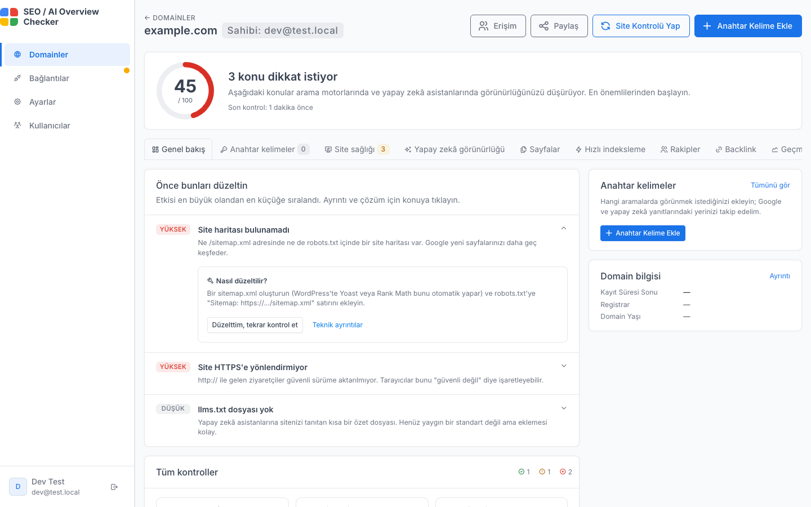

🇹🇷 Türkçe | [🇬🇧 English](README.md)

# SEO / AI Overview Checker

[](LICENSE)

Bir sitenin **klasik Google aramasında** ve **yapay zekâ yanıtlarında**
nerede durduğunu gösteren bir **Laravel** paneli: Google sıralaması, Google
**AI Overview** atıfları ve **ChatGPT, Claude, Gemini, Perplexity**'nin
siteyi anıp anmadığı ya da kaynak gösterip göstermediği. Teknik sorunları
bulur, etkisine göre sıralar ve her birinin nasıl düzeltileceğini söyler.
Kendi sunucunuzda (veya Docker ile yerelde) çalışır, geçmişi veritabanında
tutar ve Google girişiyle korunur.

Arayüz **Türkçe ve İngilizce** kullanılabilir. Tarayıcı dili Türkçe ise
Türkçe, değilse İngilizce açılır; her kullanıcı dili sonradan **Ayarlar**
sayfasından değiştirebilir.



Daha fazla ekran görüntüsü: [Özellik rehberi](docs/features.tr.md).

## Özellikler

- **Google sıralaması** — takip edilen her kelime için ilk ~20 organik
  sonucu çeker (doğrudan scraping veya DataForSEO API) ve her kontrolde
  sitenizin sırasını kaydeder.
- **Google AI Overview** — AI Overview kutusunu tespit eder, kaynak
  gösterilen domainleri listeler ve sitenizin aralarında olup olmadığını
  söyler. İstikrar görünümü son 10 kontrolde AI Overview'un ne sıklıkla
  çıktığını, sitenizin kaynaklarda ne kadar kalıcı olduğunu ve sonucun ne
  kadar dalgalandığını gösterir.
- **Yapay zekâ asistanlarında görünürlük** — ChatGPT, Claude, Gemini ve
  Perplexity'ye gerçek bir müşteri sorusu sorar; kimin anıldığını, kimin
  kaynak gösterildiğini ve hangi rakiplerin önerildiğini kaydeder.
  Yöneticiler **Prompt Explorer** ile herhangi bir soruyu dördüne birden
  sorabilir; anahtar kelimelerinizden marka içermeyen soru varyasyonları
  öneren bir sihirbaz da vardır. **Share of Model** matrisi her asistanın sitenizi SERP
  rakiplerinize göre ne sıklıkla andığını gösterir.
- **Site sağlığı** — `robots.txt`'te yapay zekâ botları, site haritası,
  `llms.txt`, HTTPS yönlendirmesi, güvenlik başlıkları, kanonik host ve
  WHOIS/domain yaşı; sağlık skoru ve öncelikli sorun listesiyle. İki kontrol
  arasındaki değişiklikler ayrıca gösterilir. **llms.txt oluşturucu** site
  haritasındaki sayfalardan gözden geçirip yükleyebileceğiniz bir taslak
  hazırlar; mevcut `llms.txt` dosyası da biçim hatalarına (metin yerine
  HTML, eksik başlık/özet/link) karşı denetlenir; dosya yoksa sorun
  kartından doğrudan oluşturucuya gidilir.
- **Hız ve sayfa kalitesi** — PageSpeed Insights API ile Lighthouse
  skorları (sunucuda Chrome gerekmez), gerçek kullanıcı CrUX verisi ve sayfa
  başına on-page SEO: title/meta, başlıklar, görseller, yapısal veri,
  hreflang.
- **Rakipler** — SERP'te bulunan domainleri takip edilen ya da yok sayılan
  olarak işaretleyin veya elle ekleyin. Takip edilen rakipler Share of Model
  satırlarını belirler; **anahtar kelime boşluğu** rakiplerin sıralandığı
  ama sizin henüz takip etmediğiniz kelimeleri listeler (DataForSEO Labs
  `ranked_keywords`, yedek olarak ücretsiz ana sayfa + site haritası
  taraması) ve tek tıkla eklemenizi sağlar. Yöneticiler hiçbir zaman rakip
  sayılmayacak domainler için genel bir **rakip kara listesi** (ör.
  `google.com`, `facebook.com`) tutar.
- **Backlink** — her domainde referring domain özeti, trend grafiği, anchor
  metinleri ve yeni/kaybedilen referring domain'leri gösteren bir Backlink
  sekmesi. Üç kaynak mükerrersiz tek listede birleşir, her satırda kaynağı
  etiketlenir:
  - **DataForSEO Backlinks API** (ücretli, çekim başına yaklaşık $0,13):
    özet, ilk 100 referring domain, anchor'lar, yeni ve kaybedilen
    domainler. Ayda bir ve "Şimdi yenile" ile istendiğinde çekilir.
  - **CrawlGraph / Common Crawl** (ücretsiz katman, ayda 15 sorgu): açık
    Common Crawl web grafiğinden link veren domainler; üç ayda bir
    yenilenir, yalnızca yeni arşiv çıkınca sorgulanır.
  - **Bing Webmaster Tools** (ücretsiz, kendi doğrulanmış siteleriniz): en
    çok link alan sayfalarınıza link veren siteler (`GetUrlLinks`), her
    site kontrolüyle toplanır.
- **Kendi verileriniz** — Google Search Console, GA4 ve Bing Webmaster
  Tools hesaplarını kullanıcı bazında (OAuth) bağlayıp tıklama, ziyaretçi ve
  backlink verisini kontrollerin yanında görün.
- **IndexNow** — anahtar dosyasını üretir ve doğrular, yeni ya da değişen
  URL'leri (veya tüm site haritasını) IndexNow arama motorlarına bildirir.
- **Paylaşım ve raporlar** — giriş gerektirmeyen salt okunur rapor linkleri
  ve haftalık SEO özeti e-postası.
- **MCP sunucusu** — Claude, ChatGPT, Cursor veya Claude Code'u OAuth ve
  Google hesabınızla bağlayın; asistan yalnızca sizin domainlerinizi görür
  ve hiçbir şeyi silemez. Bkz. [MCP sunucusu](docs/MCP.tr.md).
- **Erişim kontrolü** — davetle Google girişi, yeni kullanıcılar için
  yönetici onayı; üyeler yalnızca kendi domainlerini görür. Giriş başladığı
  adrese döner; tek kurulum birden çok domainden yayınlanabilir (her birinin
  `/auth/google/callback` adresini Google Console'a ekleyin).

## Önemli sınırlamalar ve yasal uyarı

- Sıralamalar varsayılan olarak **doğrudan HTTP scraping** ile alınır;
  daha güvenilir sonuç için `DATAFORSEO_LOGIN`/`DATAFORSEO_PASSWORD`
  tanımlayıp DataForSEO API'sine geçin. `SERP_PROVIDER=fallback` ile
  uygulama önce doğrudan scraping dener, sorguyu yalnızca Google engellerse
  DataForSEO'ya gönderir; böylece yalnızca engellenen sorgular için ödeme
  yaparsınız (bu modda mobil SERP alınmaz).
  Scraping kullanıldığında Google, otomatik istekleri sıkça
  CAPTCHA/"unusual traffic" sayfasıyla veya JavaScript doğrulaması isteyen
  bir yönlendirmeyle (`/httpservice/retry/enablejs`) engelleyebilir. Uygulama
  bu durumları tespit edip "engellendi" olarak raporlar; sonuç alamıyorsanız
  önce bunu kontrol edin.
- **AI Overview genellikle istemci tarafında (JavaScript ile) render edilir**
  ve hesap/konum/cihaza göre değişebilir. Bu araç yalnızca statik HTML
  yanıtını inceler; bu yüzden tespit **en iyi çaba (best-effort)**
  niteliğindedir ve gerçekte görünen bir AI Overview burada
  yakalanamayabilir.
- Google'ın SERP HTML yapısı sık değişir; ayrıştırma mantığı genel
  sezgisel (heuristic) kurallara dayanır ve zamanla güncellenmesi
  gerekebilir (bkz. `config/seo.php` içindeki `ai_overview_markers` ve
  `ai_overview_selectors`).
- Bu aracı yalnızca **kendi sitelerinizi/kendi izniniz olan siteleri**
  denetlemek için, makul istek sıklığıyla (`REQUEST_DELAY_MS`) kullanın.
  Google'ın hizmet şartlarını ve robots.txt kurallarını göz önünde
  bulundurun; yoğun veya toplu (mass) scraping yapılandırmayın.
- PageSpeed Insights API'sinin **API anahtarsız** kullanımında kota çok
  düşüktür ve hızla "Quota exceeded" hatasına düşebilirsiniz; gerçek
  kullanım için `PSI_API_KEY` almanız önerilir (bkz. aşağı).

## Hızlı başlangıç (Docker)

```bash
docker network create npm_proxy   # tek seferlik, bkz. docs/docker.tr.md
cp .env.docker.example .env

docker compose build
docker compose up -d

docker compose exec app php artisan migrate
```

Panel varsayılan olarak `http://localhost:8080` adresinde çalışır.

Derlemek istemiyor musunuz? Her sürüm için **amd64/arm64** tek hazır imaj (nginx + php-fpm)
GHCR'de (`ghcr.io/bmericc/seo-ai-checker`) ve Docker Hub'da
(`bmericc/seo-ai-checker`) yayınlanır; `docker-compose.release.yml` ile
çalıştırın, bkz. [Hazır imajlar](docs/docker.tr.md#hazır-imajlar-derleme-yok).

Google girişini kurmak için [Web Arayüzü](docs/web-dashboard.md) sayfasına devam edin.

## Dokümantasyon

- [Özellik rehberi](docs/features.tr.md) — ekran görüntüleriyle ekran ekran
  anlatım: her bölüm ne gösterir, hangi API'yi ister.
- [Docker kurulum adımları](docs/docker-install.tr.md) — hazır imajla veya
  kaynak koddan adım adım kurulum, tüm API anahtarları, güncelleme ve
  yedekleme.
- [Docker ile çalıştırma](docs/docker.tr.md) — dev, production, hazır
  imajlar, nginx-proxy-manager arkasında ve Docker olmadan elle kurulum.
- [Zamanlanmış görevler](docs/scheduled-tasks.tr.md) — neyin otomatik, ne
  zaman çalıştığı ve maliyeti.
- [Web paneli](docs/web-dashboard.tr.md) — Google OAuth kurulumu, `.env`
  referansı, Docker olmadan kurulum ve günlük kullanım.
- [Kullanıcı yönetimi ve yönetim paneli](docs/admin.tr.md) — kullanıcı
  onayı, yönetici rolleri.
- [MCP sunucusu](docs/MCP.tr.md) — yapay zekâ asistanlarını bağlama,
  izinler ve araçlar.
- [Mimari](docs/architecture.tr.md) — proje yapısı, AI Overview tespiti ve
  Lighthouse entegrasyonunun nasıl çalıştığı, veritabanı şeması ve temel
  servisler.
- [Geliştirme](docs/development.tr.md) — yerel kurulum ve testlerin
  çalıştırılması.
- [Değişiklik günlüğü](CHANGELOG.tr.md) — her sürümde neyin değiştiği.
- [Katkıda bulunma](CONTRIBUTING.tr.md) — hata bildirme ve değişiklik
  gönderme.
- [Güvenlik politikası](SECURITY.tr.md) — güvenlik açıklarını gizli
  bildirme.

Tüm belgelerin İngilizcesi de var.

## Lisans

[GNU General Public License v3.0 veya sonrası](LICENSE) (GPL-3.0-or-later) ile lisanslanmıştır.
