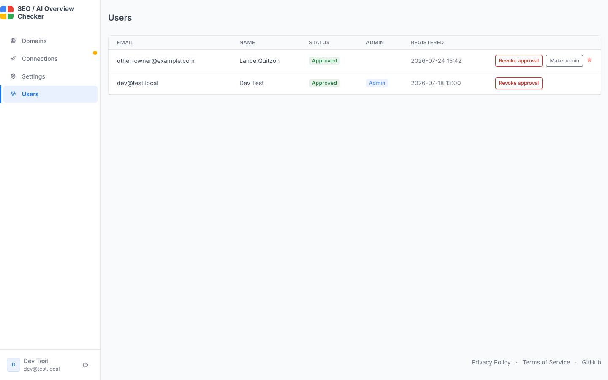

🇬🇧 English | [🇹🇷 Türkçe](admin.tr.md)

[← Back to README](../README.md)

# User management and admin panel

- Anyone can sign up with Google or with email + password and get a `User`
  record; `approved_at` is empty by default (pending approval) and the
  dashboard is inaccessible until then. Email + password accounts must
  verify their email before they reach the pending approval page.
- Emails in the `ADMIN_EMAILS` list (`.env`/`.env.prod`) are automatically
  set to `is_admin=true` + approved on their first Google login, or when an
  email + password account verifies its email (to give yourself access on
  initial setup).
- Admin users can approve other users, revoke their approval, promote/demote
  admin status, or delete them from the `/admin/users` page (the "Users"
  link in the top menu). An admin cannot perform these actions on their own
  account (to prevent accidentally locking themselves out); this isn't an
  issue for an `ADMIN_EMAILS` account anyway, since it's automatically
  reset to admin+approved on every login.

