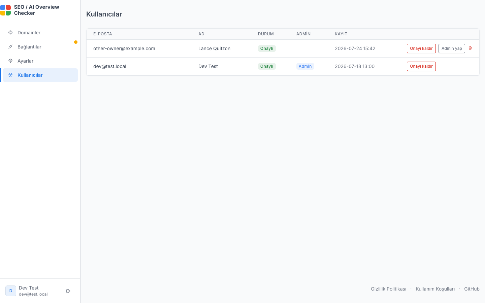

🇹🇷 Türkçe | [🇬🇧 English](admin.md)

[← README'ye dön](../README.tr.md)

# Kullanıcı yönetimi ve yönetim paneli

- Herkes Google ile ya da e-posta + şifreyle kayıt olup bir `User` kaydı
  oluşturabilir. `approved_at` varsayılan olarak boştur (onay bekliyor) ve
  onaylanana kadar panele erişilemez. E-posta + şifreli hesaplar onay
  bekleme sayfasına düşmeden önce e-postalarını doğrulamalıdır.
- `ADMIN_EMAILS` listesindeki (`.env`/`.env.prod`) e-postalar ilk Google
  girişinde ya da e-posta + şifreli hesap e-postasını doğrulayınca otomatik
  olarak `is_admin=true` ve onaylı olur (ilk kurulumda kendinize erişim
  açmak için).
- Yöneticiler `/admin/users` sayfasından (menüdeki "Kullanıcılar" linki)
  diğer kullanıcıları onaylayabilir, onayını kaldırabilir, yönetici
  yapabilir/yöneticilikten alabilir veya silebilir. Bir yönetici bu
  işlemleri kendi hesabına uygulayamaz (yanlışlıkla kendini dışarıda
  bırakmasın diye). `ADMIN_EMAILS` hesapları için bu zaten sorun değildir;
  her girişte yeniden yönetici ve onaylı yapılırlar.

