🇬🇧 English | [🇹🇷 Türkçe](features.tr.md)

[← Back to README](../README.md)

# Feature guide

A screen-by-screen tour of the dashboard: what each part shows, how to use
it and which API it needs. For API keys see
[Docker installation steps → Available APIs](docker-install.md#available-apis).

The screenshots come from a local test install with sample data
(`example.com`), so most numbers are empty.

## Landing page

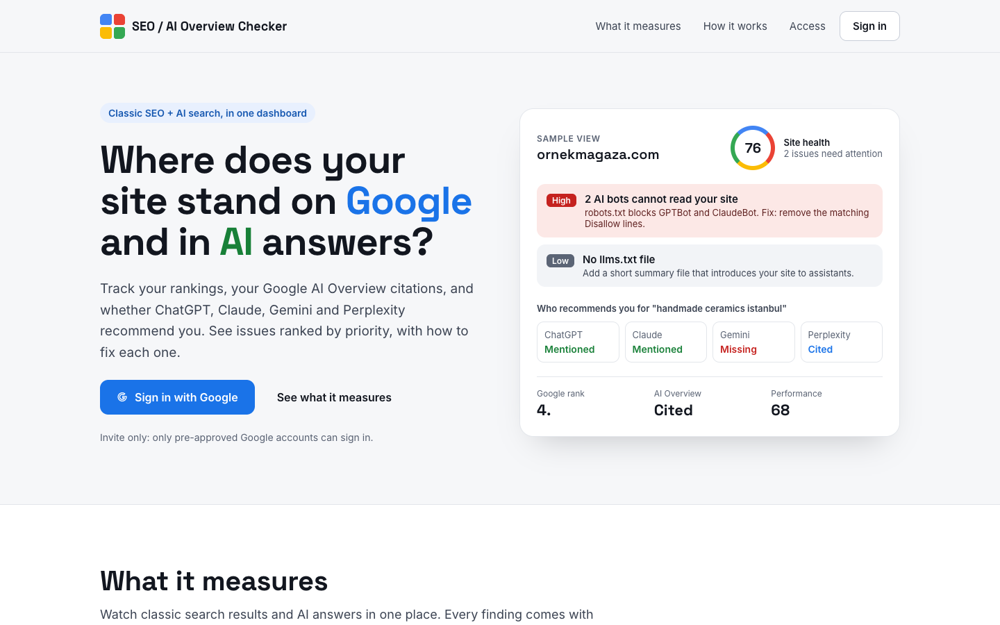

Visitors who are not signed in see a short product page. Sign-in is
**Google only** and invite-only: new accounts wait for an admin's approval
(see [Admin](#admin-users)).

## Domains

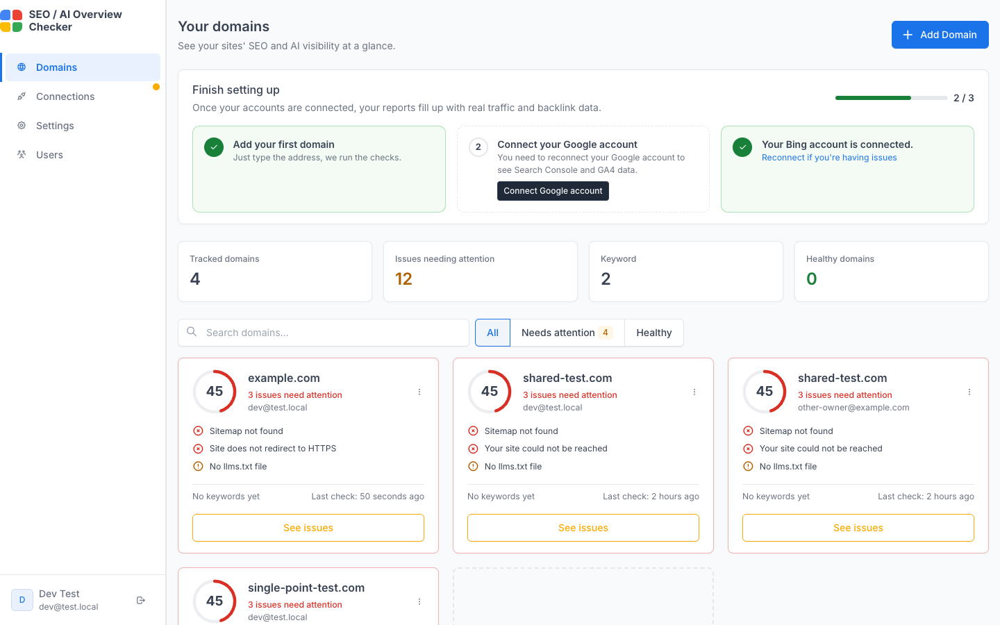

The home page after sign-in. It lists your domains with their health score,
issue count and last check, plus a setup checklist (add a domain, connect
Google, connect Bing). Use **Add Domain** to start tracking a site.

You see only domains you own or were invited to.

## Domain page

Each domain has a header with these actions:

- **Access** — invite other users to this domain and set their role.
- **Share** — create a read-only report link that works without sign-in.
  Links can be revoked at any time.
- **Run Site Check** — runs all site checks now (also runs every night).
- **Add Keyword** — start tracking a search phrase for this domain.

### Overview

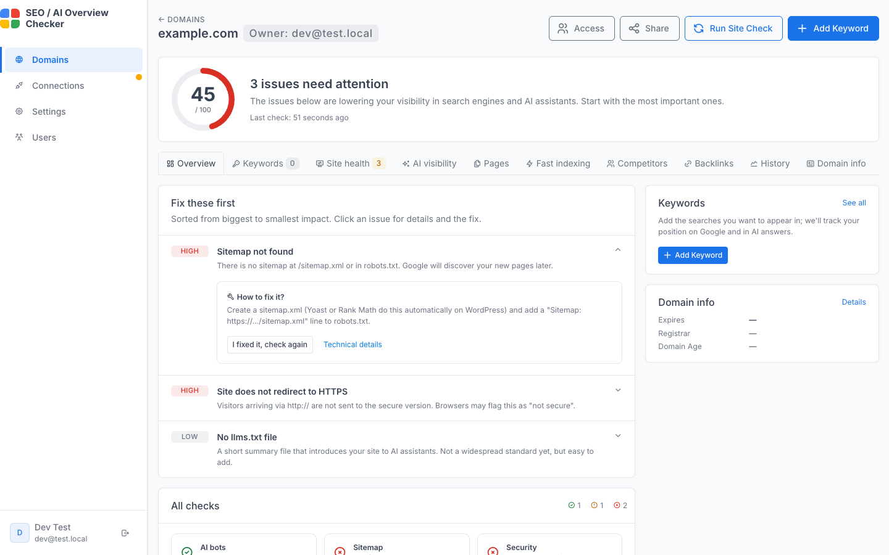

A health score out of 100 and the issues lowering it, sorted by impact.
Each issue opens to show **how to fix it**, an **I fixed it, check again**
button and a link to the technical details. Below are all checks at a
glance, your keywords and domain (WHOIS) info.

### Keywords

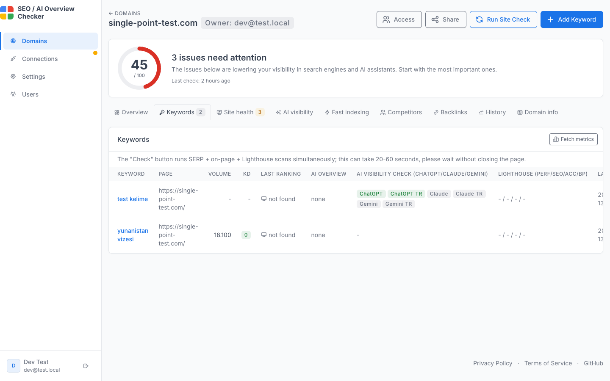

All tracked keywords with Google position, AI Overview status and AI
assistant results from the latest check. Keyword suggestions found by
crawling your site can be added in one click or dismissed. **Fetch
metrics** pulls search volume, difficulty, CPC and intent (DataForSEO).

### Site health

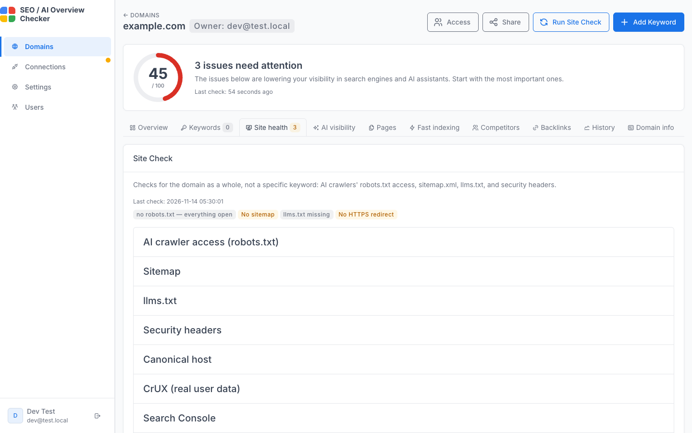

The technical details behind the score:

- AI bots (GPTBot, ClaudeBot, PerplexityBot...) allowed or blocked in
  `robots.txt`
- sitemap found and readable
- `llms.txt` present and well formed
- HTTPS redirect, security headers, canonical host
- Core Web Vitals from real users (CrUX)
- Search Console, GA4 and Bing data once connected; the GA4 property is
  picked here

Changes since the previous check are highlighted, so a broken deploy shows
up the next morning (**drift**).

### AI visibility

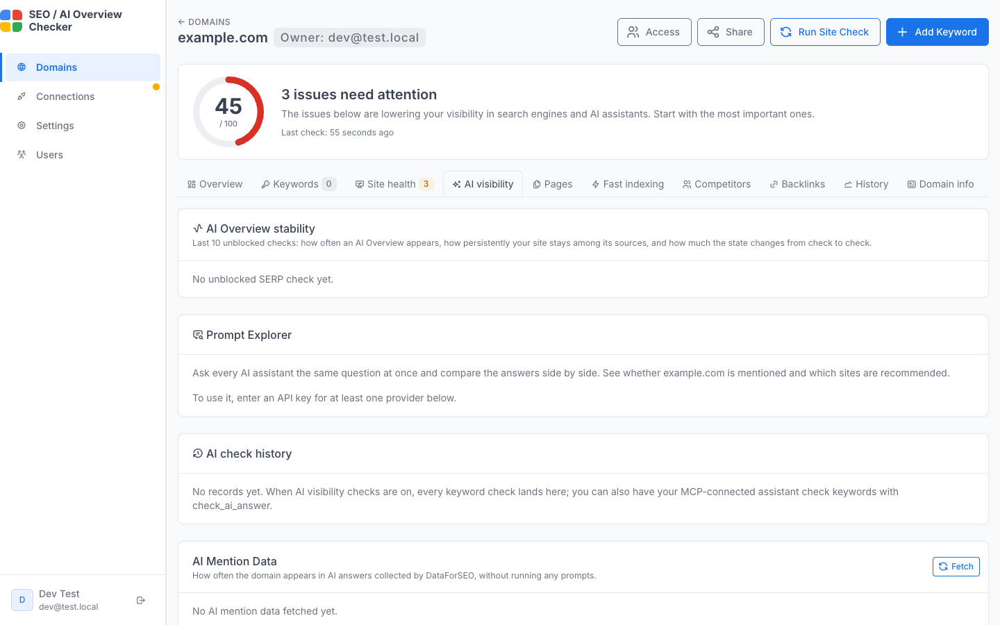

- **AI Overview stability** — over the last 10 unblocked checks: how often
  an AI Overview appears, how often your site is cited and how much the
  result changes.
- **Prompt Explorer** — ask one question to ChatGPT, Claude, Gemini and
  Perplexity at once and compare the answers side by side: is your brand
  mentioned, which sites are recommended. A wizard suggests brand-free
  questions from your keywords.
- **AI check history** — results from keyword checks and MCP
  `check_ai_answer` calls.
- **AI mention data** — how often the domain appears in AI answers
  collected by DataForSEO, without running prompts yourself.
- **Share of Model** — how often each assistant mentions you versus your
  tracked competitors.
- **API keys** — OpenAI, Anthropic, Gemini and Perplexity keys are entered
  here, **per domain**, and stored encrypted. A label (personal / client)
  helps track whose budget is spent.

### Pages and Lighthouse

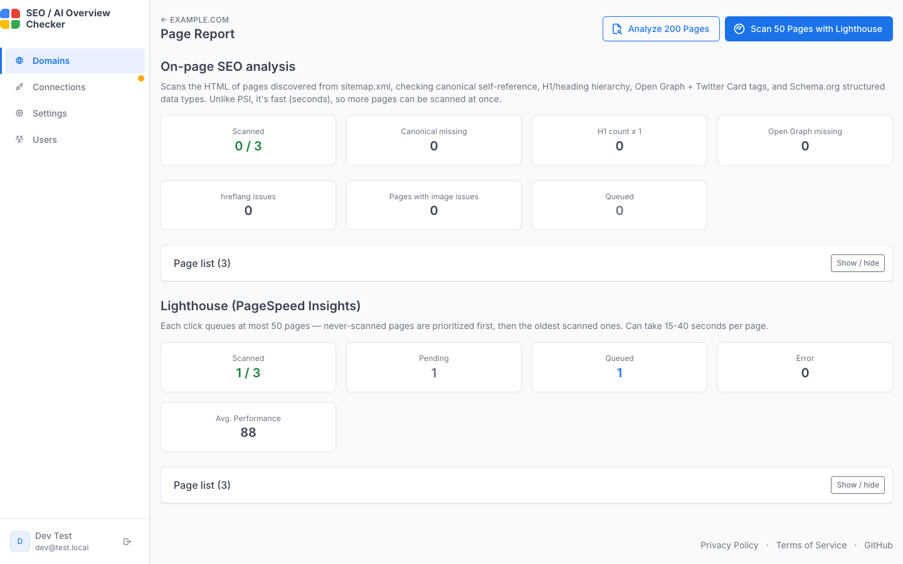

The **Pages** tab lists the pages from your sitemap. The **Lighthouse
report** runs PageSpeed Insights (performance, SEO, accessibility, best
practices) and on-page checks for every page in the background and shows
the results as a table. Needs a running `worker`; a `PSI_API_KEY` is
strongly recommended.

### llms.txt generator

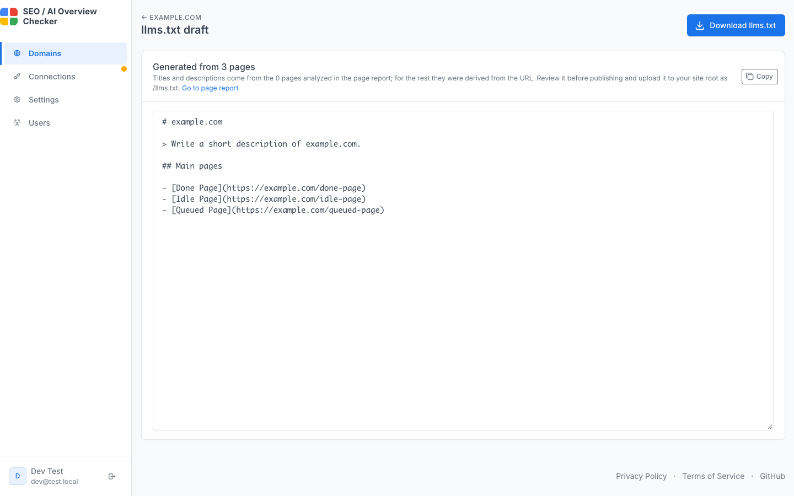

Builds a draft `llms.txt` from your sitemap pages. Review it, download it
and upload it to your site root.

### Fast indexing (IndexNow)

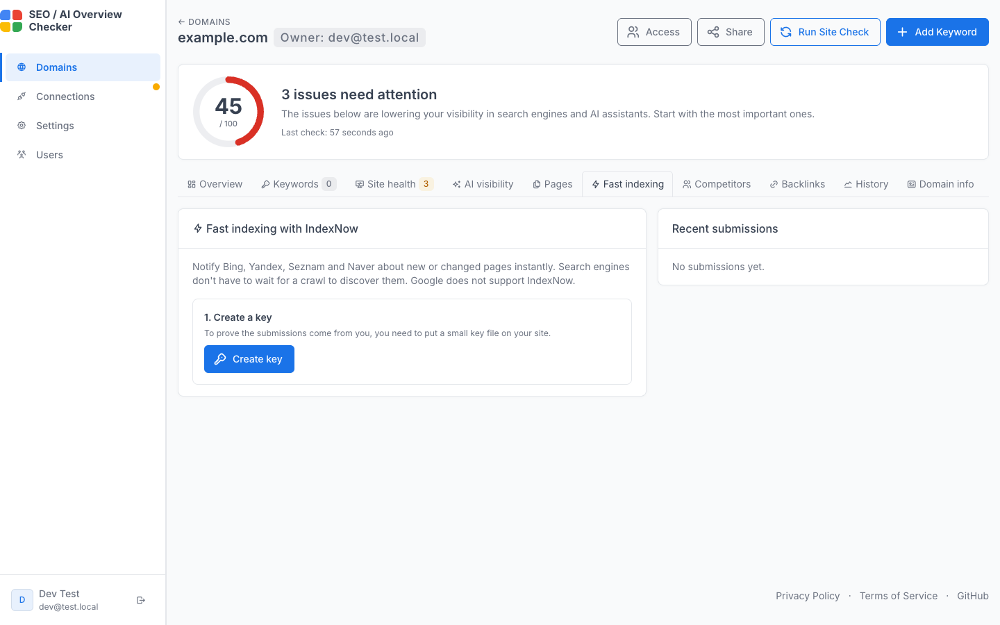

1. Download the generated key file and upload it to your site root.
2. Click **Check the file**.
3. Submit single URLs or the whole sitemap. The submission goes to
   `api.indexnow.org`, which shares it with all IndexNow engines (Bing,
   Yandex, Seznam, Naver...).

### Competitors

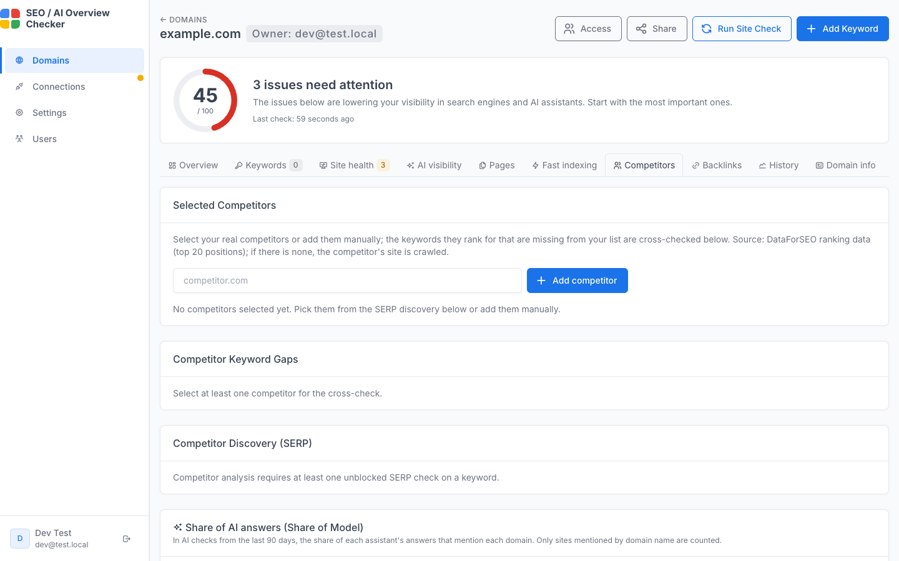

**Competitor discovery (SERP)** lists domains that keep appearing in your
SERPs. Pick them with **Select as competitor** or hide them with **Not a
competitor**, or use **Add competitor** to add one by hand. Selected
competitors are used in Share of Model, and **Competitor Keyword Gaps**
lists keywords they rank for that you don't track yet (DataForSEO Labs,
with a free homepage + sitemap crawl fallback), ready to add in one click.

### Backlinks

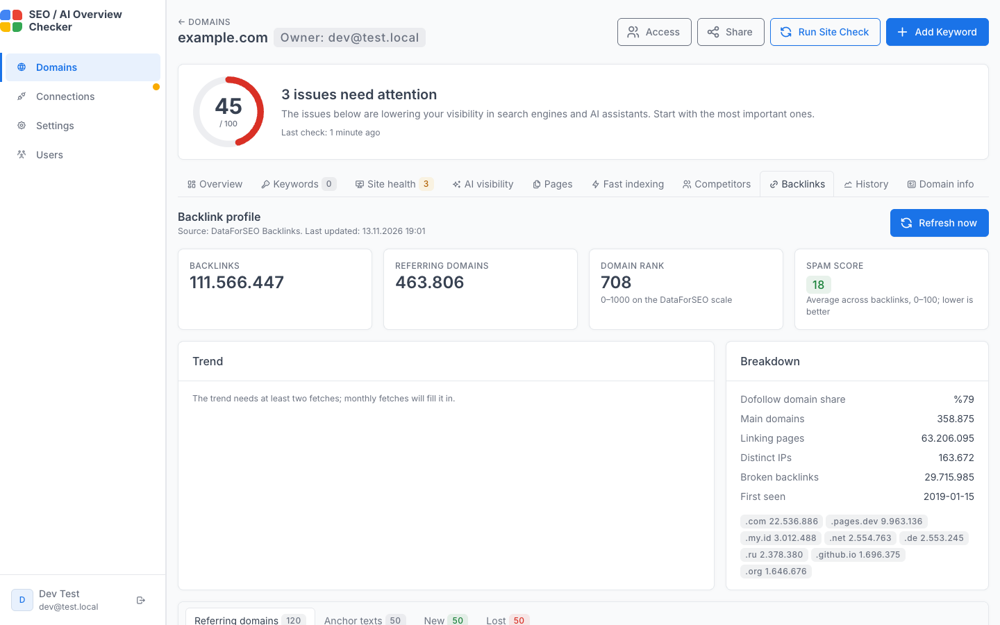

Referring domains, trend chart, anchors and new/lost domains, merged from
three sources and labelled by source:

| Source | Cost | Refresh |
|---|---|---|
| DataForSEO Backlinks | about $0.13 per fetch | monthly and with **Refresh now** |
| CrawlGraph (Common Crawl) | free, 15 lookups a month | when a new archive is released (quarterly) |
| Bing Webmaster Tools | free, your own verified sites | with every site check |

### History

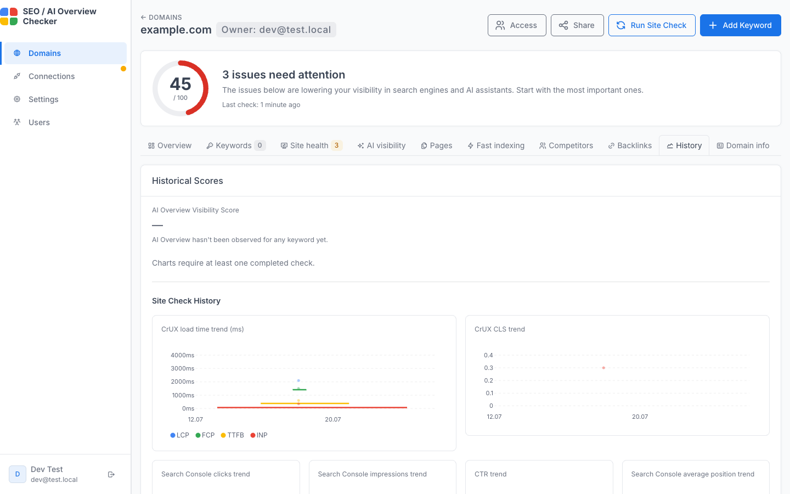

Health score and check results over time.

### Domain info

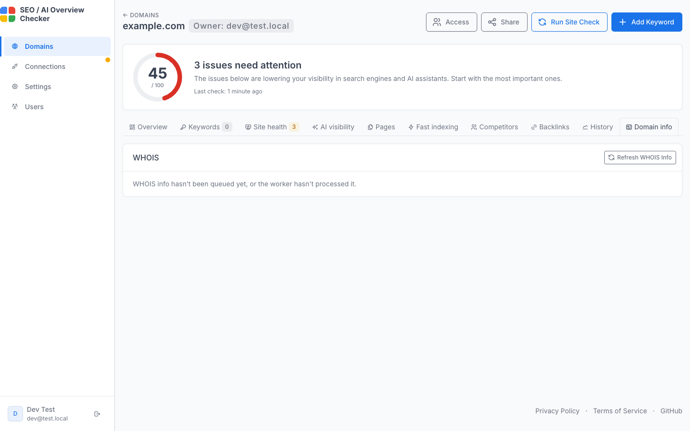

WHOIS data: registrar, expiry date and domain age.

## Keyword detail

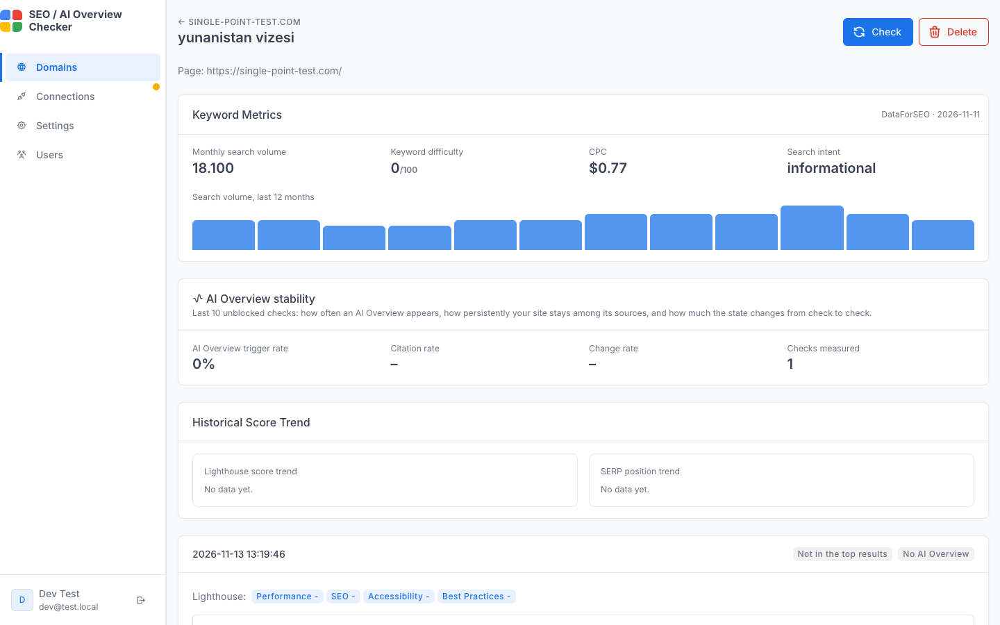

One keyword's full picture:

- **Keyword metrics** — monthly volume, 12-month trend, difficulty, CPC and
  intent (DataForSEO).
- **AI Overview stability** for this keyword.
- **Score trends** — Lighthouse and SERP position over time.
- **Check list** — every check with the top results, AI Overview sources,
  AI assistant answers, on-page findings and Lighthouse scores. The raw
  Lighthouse JSON can be downloaded.

**Check** runs a full check now. Weekly checks run automatically (see
[Scheduled tasks](scheduled-tasks.md)).

## Connections

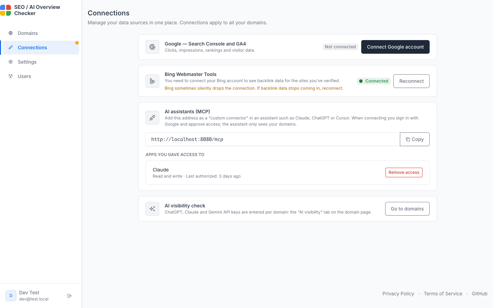

Per-user OAuth connections:

- **Google** — Search Console (clicks, impressions, queries) and GA4
  (visitors) next to the checks.
- **Bing Webmaster Tools** — Bing data and backlinks for your verified
  sites.
- **MCP clients** — AI assistants connected through the MCP server; revoke
  them here. See [MCP server](MCP.md).

## Settings

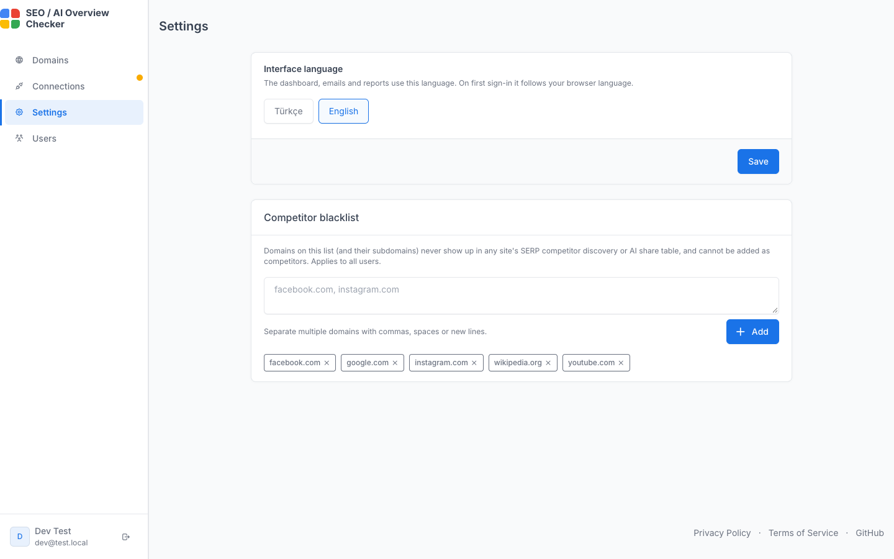

- **Interface language** — Turkish or English. On first sign-in it follows
  the browser language. Emails and reports use the same language.
- **Competitor blacklist** (admins) — domains never offered as competitors,
  for all users (e.g. `google.com`, `facebook.com`).

## Admin: users

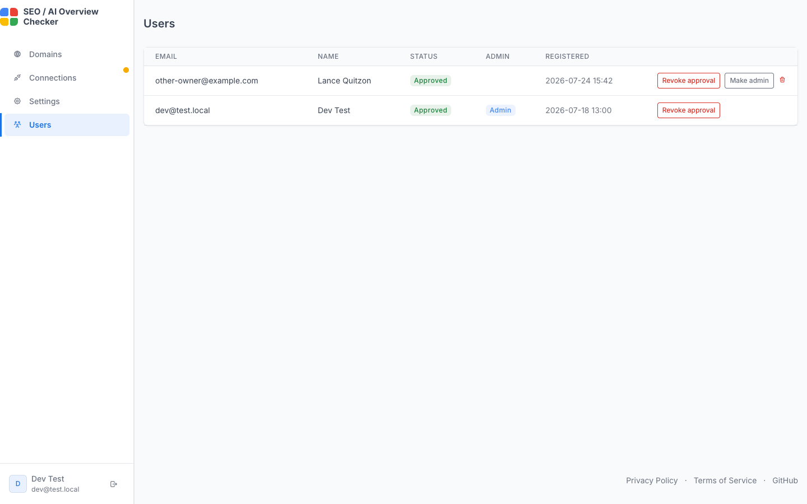

Admins approve new users, revoke access, grant or remove admin rights and
delete users. Accounts in `ADMIN_EMAILS` become admins automatically on
first sign-in. Details: [User management and admin panel](admin.md).

## Weekly email report

Every Monday each approved user with at least one checked domain gets a
summary email. Mail must be configured (`MAIL_MAILER`, `MAIL_HOST`...);
the default `log` mailer only writes it to the log.
