🇹🇷 Türkçe | [🇬🇧 English](features.md)

[← README'ye dön](../README.tr.md)

# Özellik rehberi

Paneli ekran ekran anlatır: her bölüm ne gösterir, nasıl kullanılır, hangi
API'yi ister. API anahtarları için bkz.
[Docker kurulum adımları → Kullanılabilecek API'ler](docker-install.tr.md#kullanılabilecek-apiler).

Ekran görüntüleri örnek veriyle (`example.com`) çalışan yerel bir test
kurulumundan alındı, bu yüzden çoğu sayı boş.

## Giriş sayfası

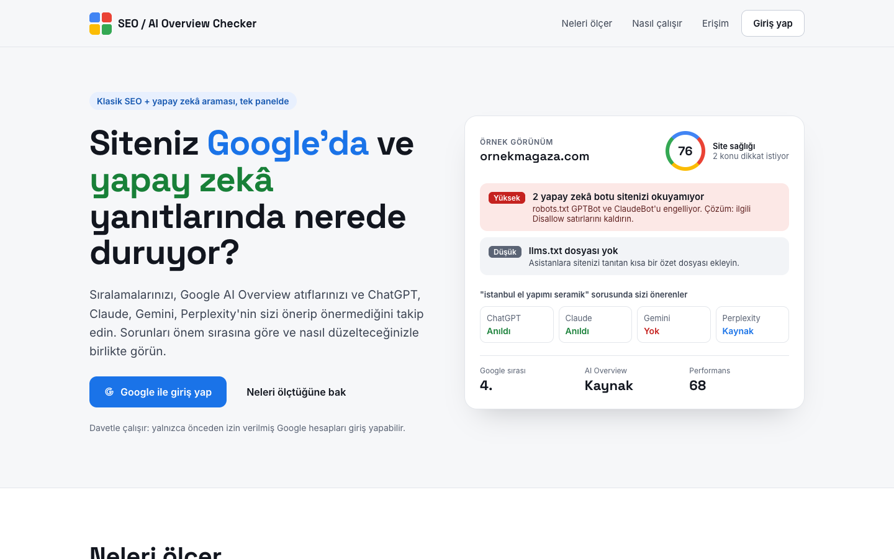

Giriş yapmamış ziyaretçiler kısa bir tanıtım sayfası görür. Giriş
**yalnızca Google** ile yapılır ve davetlidir: yeni hesaplar bir yöneticinin
onayını bekler (bkz. [Yönetim](#yönetim-kullanıcılar)).

## Domainler

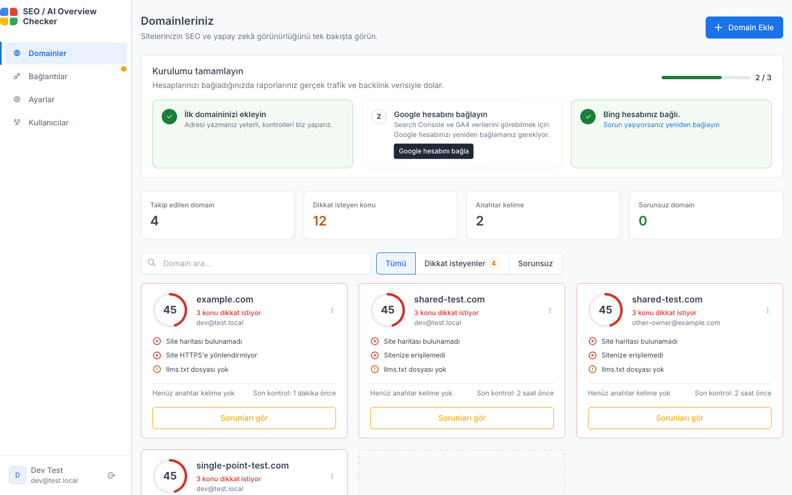

Girişten sonraki ana sayfa. Domainleriniz sağlık skoru, sorun sayısı ve son
kontrol zamanıyla listelenir. Üstte bir kurulum listesi vardır (domain ekle,
Google'ı bağla, Bing'i bağla). Bir siteyi takibe almak için **Domain Ekle**.

Yalnızca sahibi olduğunuz veya davet edildiğiniz domainleri görürsünüz.

## Domain sayfası

Her domainin başlığında şu işlemler var:

- **Erişim** — başka kullanıcıları bu domaine davet edin, rollerini seçin.
- **Paylaş** — giriş gerektirmeyen, salt okunur bir rapor linki oluşturun.
  Link istediğiniz zaman iptal edilebilir.
- **Site Kontrolü Yap** — tüm site kontrollerini hemen çalıştırır (her gece
  de otomatik çalışır).
- **Anahtar Kelime Ekle** — bu domain için bir arama ifadesini takibe alın.

### Genel bakış

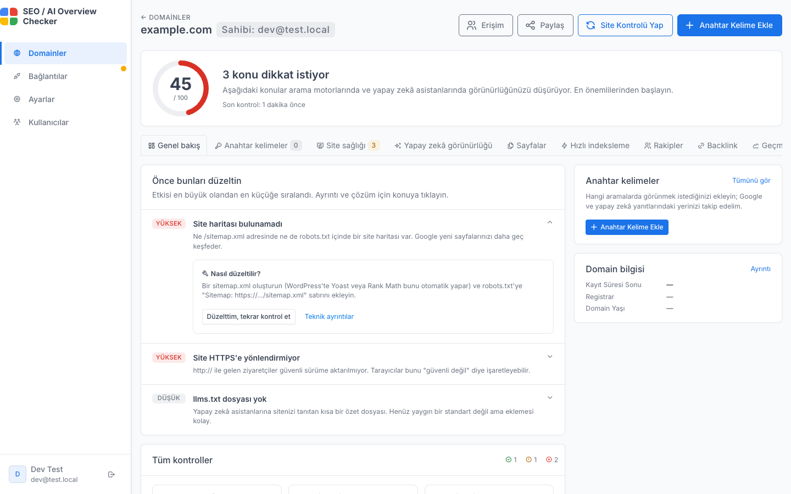

100 üzerinden sağlık skoru ve onu düşüren sorunlar, etkisine göre sıralı.
Her sorun açıldığında **nasıl düzeltileceğini**, **Düzelttim, tekrar kontrol
et** butonunu ve teknik ayrıntı linkini gösterir. Altta tüm kontrollerin
özeti, anahtar kelimeleriniz ve domain (WHOIS) bilgisi var.

### Anahtar kelimeler

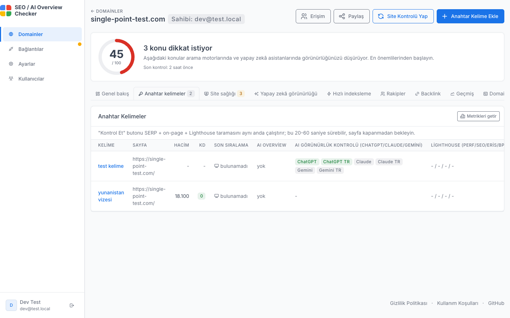

Takip edilen tüm kelimeler; son kontroldeki Google sırası, AI Overview
durumu ve yapay zekâ asistanı sonuçlarıyla. Sitenizin taranmasıyla bulunan
kelime önerileri tek tıkla eklenebilir veya gizlenebilir. **Metrikleri
getir** arama hacmi, zorluk, TBM ve arama niyetini getirir (DataForSEO).

### Site sağlığı

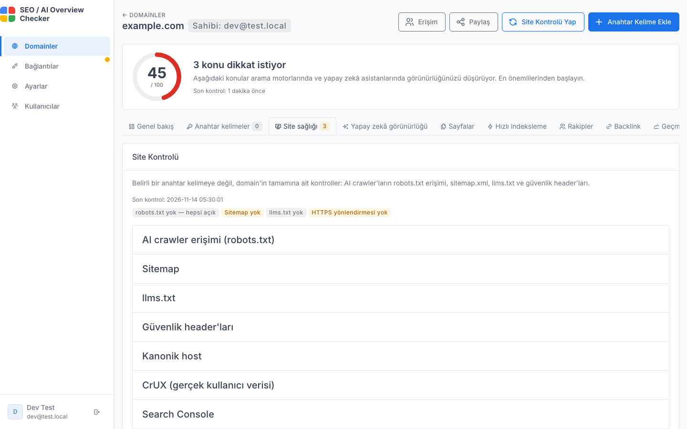

Skorun arkasındaki teknik ayrıntılar:

- yapay zekâ botları (GPTBot, ClaudeBot, PerplexityBot...) `robots.txt`
  içinde açık mı, engelli mi
- site haritası bulunuyor ve okunabiliyor mu
- `llms.txt` var mı, biçimi doğru mu
- HTTPS yönlendirmesi, güvenlik başlıkları, kanonik host
- gerçek kullanıcı Core Web Vitals verisi (CrUX)
- bağlıysa Search Console, GA4 ve Bing verileri; GA4 mülkü burada seçilir

Bir önceki kontrole göre değişenler vurgulanır; bozuk bir yayın ertesi
sabah görünür (**drift**).

### Yapay zekâ görünürlüğü

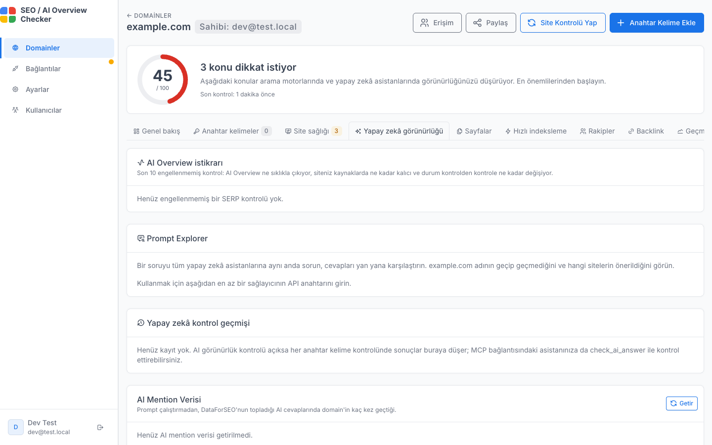

- **AI Overview istikrarı** — engellenmemiş son 10 kontrolde AI Overview ne
  sıklıkla çıkıyor, siteniz ne sıklıkla kaynak gösteriliyor, sonuç ne kadar
  değişiyor.
- **Prompt Explorer** — tek bir soruyu ChatGPT, Claude, Gemini ve
  Perplexity'ye aynı anda sorun, cevapları yan yana karşılaştırın: markanız
  geçiyor mu, hangi siteler öneriliyor. Sihirbaz, kelimelerinizden marka
  adı içermeyen sorular önerir.
- **Yapay zekâ kontrol geçmişi** — anahtar kelime kontrollerinden ve MCP
  `check_ai_answer` çağrılarından gelen sonuçlar.
- **AI Mention verisi** — kendiniz prompt çalıştırmadan, DataForSEO'nun
  topladığı yapay zekâ cevaplarında domainin kaç kez geçtiği.
- **Share of Model** — her asistanın sizi, takip ettiğiniz rakiplere göre
  ne sıklıkla andığı.
- **API anahtarları** — OpenAI, Anthropic, Gemini ve Perplexity anahtarları
  burada, **domain başına** girilir ve şifreli saklanır. Etiket (bireysel /
  müşteri) hangi bütçeden harcandığını takip etmeye yarar.

### Sayfalar ve Lighthouse

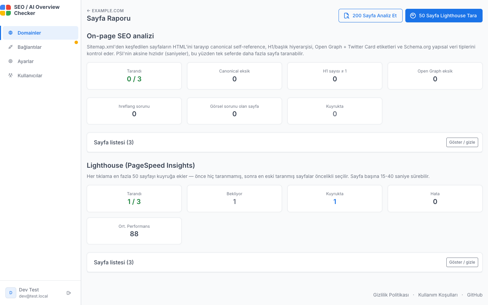

**Sayfalar** sekmesi site haritanızdaki sayfaları listeler. **Lighthouse
raporu** her sayfa için arka planda PageSpeed Insights (performans, SEO,
erişilebilirlik, en iyi uygulamalar) ve sayfa içi kontrolleri çalıştırır,
sonuçları tablo olarak gösterir. Çalışan bir `worker` gerekir; `PSI_API_KEY`
şiddetle önerilir.

### llms.txt üretici

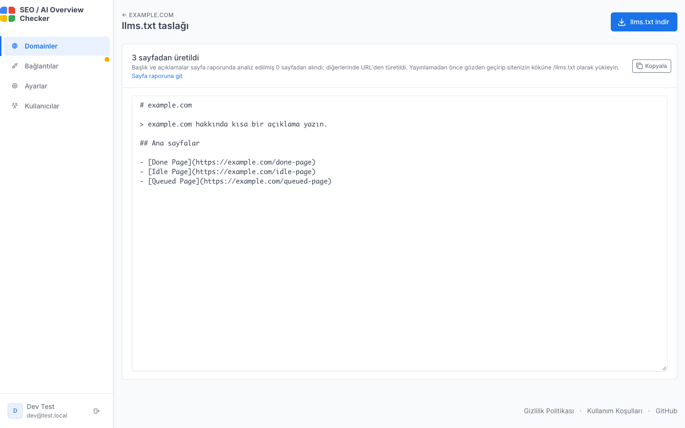

Site haritanızdaki sayfalardan taslak bir `llms.txt` oluşturur. İnceleyin,
indirin ve sitenizin kök dizinine yükleyin.

### Hızlı indeksleme (IndexNow)

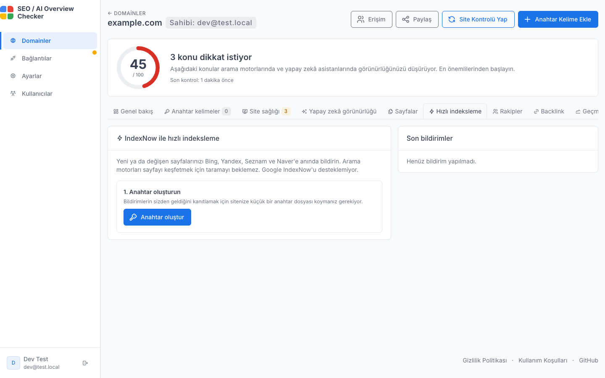

1. Oluşturulan anahtar dosyasını indirip sitenizin kök dizinine yükleyin.
2. **Dosyayı kontrol et**'e tıklayın.
3. Tek tek URL'leri ya da tüm site haritasını gönderin. Gönderim
   `api.indexnow.org` adresine gider; o da tüm IndexNow arama motorlarıyla
   (Bing, Yandex, Seznam, Naver...) paylaşır.

### Rakipler

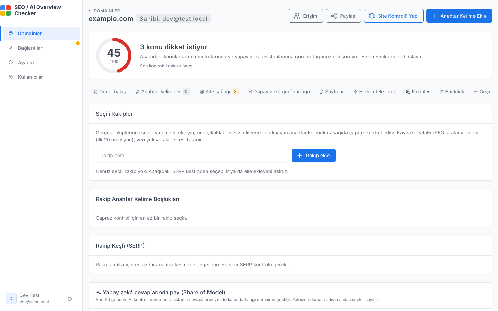

**Rakip Keşfi (SERP)**, SERP'lerinizde tekrar eden domainleri listeler.
**Rakip olarak seç** ile seçin, **Rakip değil** ile gizleyin ya da **Rakip
ekle** ile elle ekleyin. Seçili rakipler Share of Model'de kullanılır.
**Rakip Anahtar Kelime Boşlukları**, onların sıralandığı ama sizin henüz
takip etmediğiniz kelimeleri listeler (DataForSEO Labs; yoksa ana sayfa ve
site haritası taraması); tek tıkla eklenebilir.

### Backlink

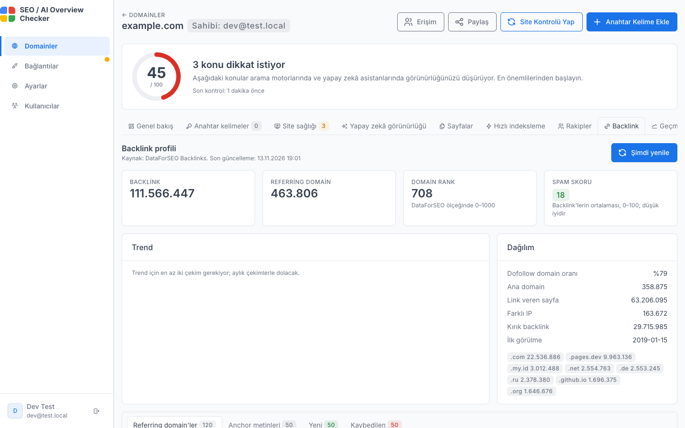

Link veren domainler, trend grafiği, anchor metinleri ve yeni/kaybolan
domainler. Üç kaynak tek listede birleşir, her satırda kaynağı yazar:

| Kaynak | Ücret | Yenilenme |
|---|---|---|
| DataForSEO Backlinks | çekim başına yaklaşık 0,13 $ | aylık ve **Şimdi yenile** ile |
| CrawlGraph (Common Crawl) | ücretsiz, ayda 15 sorgu | yeni arşiv çıkınca (üç ayda bir) |
| Bing Webmaster Tools | ücretsiz, doğrulanmış kendi siteleriniz | her site kontrolünde |

### Geçmiş

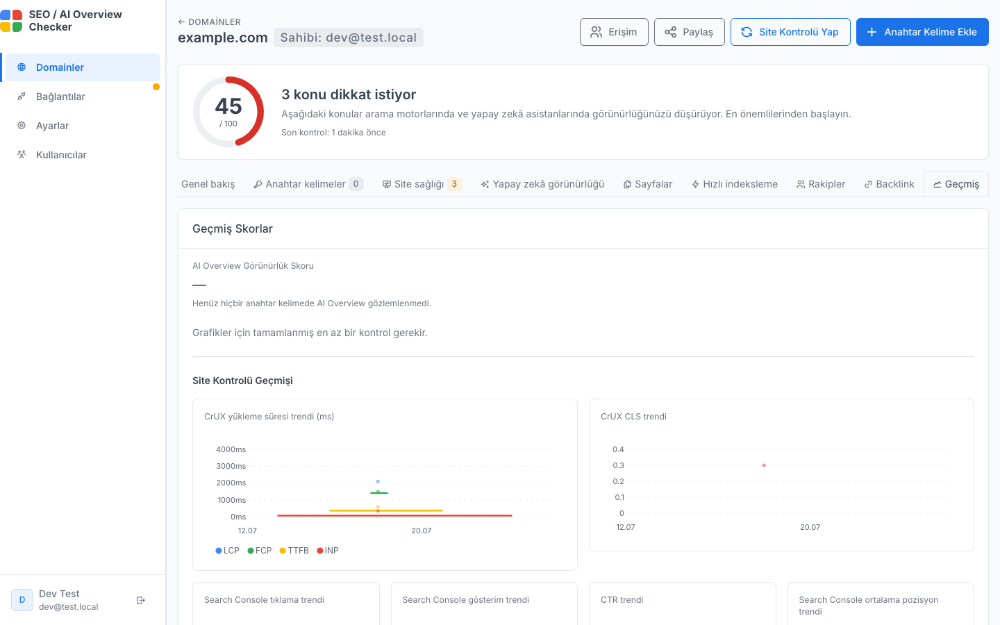

Sağlık skoru ve kontrol sonuçlarının zaman içindeki değişimi.

### Domain bilgisi

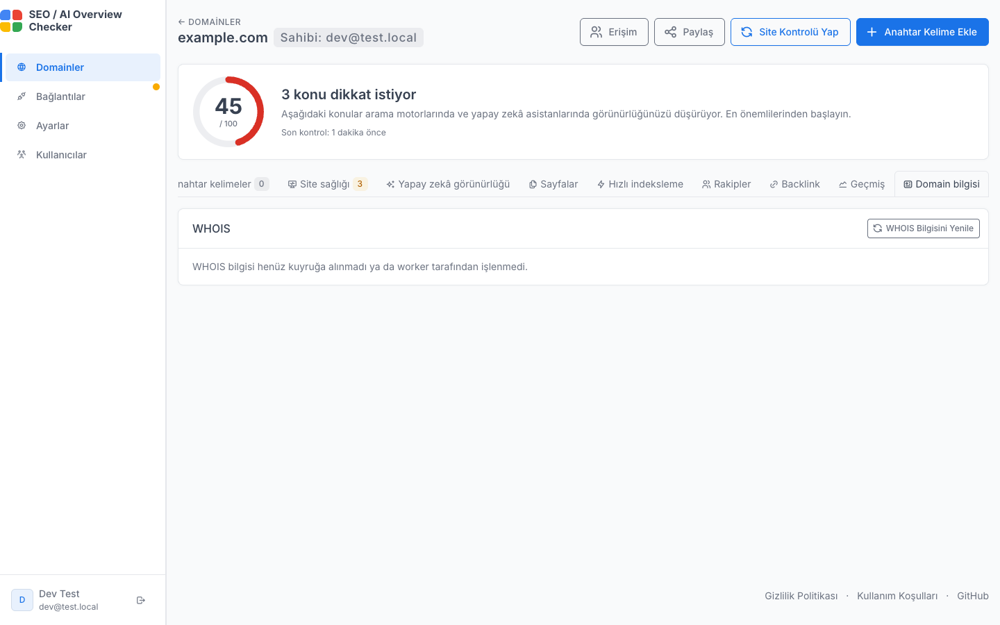

WHOIS verisi: kayıt firması, bitiş tarihi ve domain yaşı.

## Anahtar kelime ayrıntısı

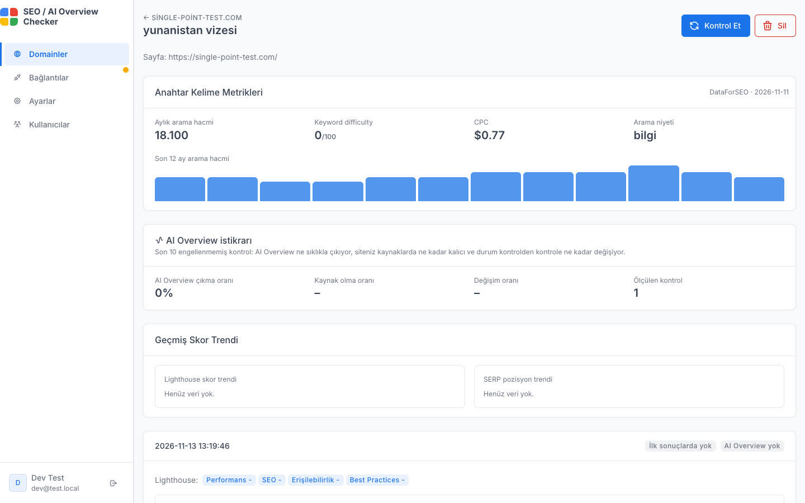

Tek bir kelimenin tüm resmi:

- **Kelime metrikleri** — aylık hacim, 12 aylık trend, zorluk, TBM ve niyet
  (DataForSEO).
- Bu kelime için **AI Overview istikrarı**.
- **Skor trendleri** — Lighthouse ve SERP sırası zaman içinde.
- **Kontrol listesi** — her kontrolde ilk sonuçlar, AI Overview kaynakları,
  yapay zekâ asistanı cevapları, sayfa içi bulgular ve Lighthouse skorları.
  Ham Lighthouse JSON'u indirilebilir.

**Kontrol Et** tam kontrolü hemen çalıştırır. Haftalık kontroller otomatik
çalışır (bkz. [Zamanlanmış görevler](scheduled-tasks.tr.md)).

## Bağlantılar

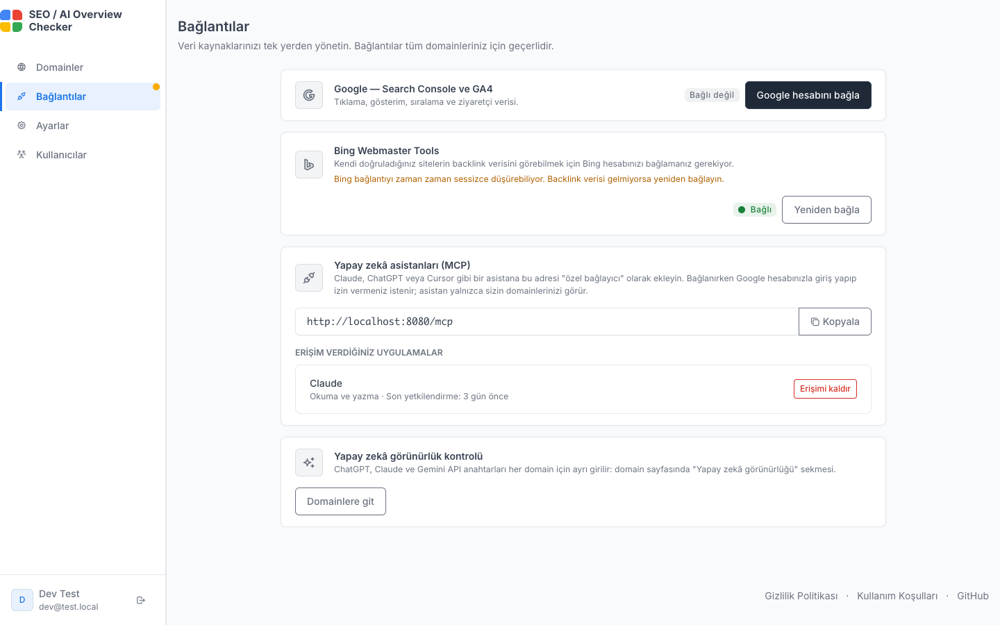

Kullanıcı başına OAuth bağlantıları:

- **Google** — kontrollerin yanında Search Console (tıklama, gösterim,
  sorgular) ve GA4 (ziyaretçi) verisi.
- **Bing Webmaster Tools** — doğrulanmış siteleriniz için Bing verisi ve
  backlink'ler.
- **MCP istemcileri** — MCP sunucusu üzerinden bağlanan yapay zekâ
  asistanları; buradan kaldırılabilir. Bkz. [MCP sunucusu](MCP.tr.md).

## Ayarlar

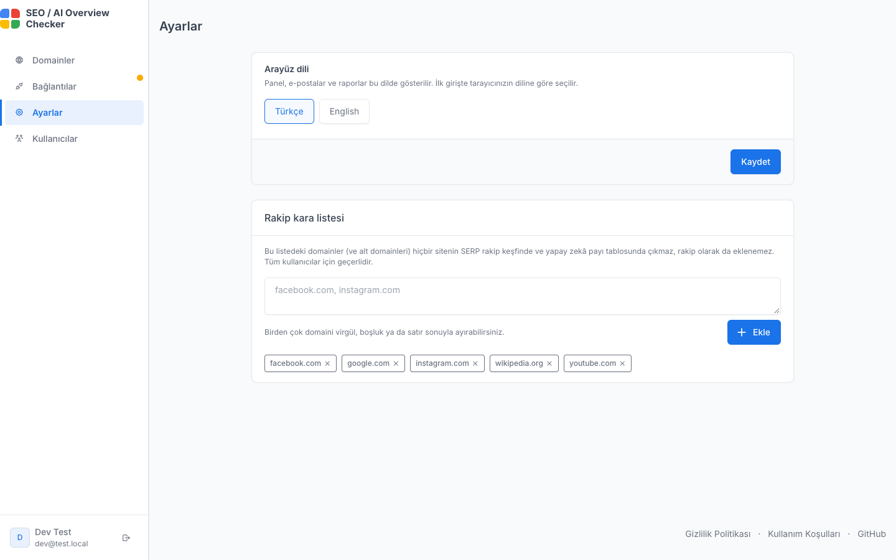

- **Arayüz dili** — Türkçe veya İngilizce. İlk girişte tarayıcı dilini
  izler. E-postalar ve raporlar da bu dili kullanır.
- **Rakip kara listesi** (yöneticiler) — hiçbir kullanıcıya rakip olarak
  önerilmeyecek domainler (örn. `google.com`, `facebook.com`).

## Yönetim: kullanıcılar

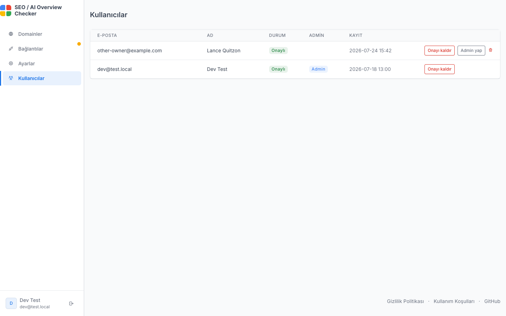

Yöneticiler yeni kullanıcıları onaylar, erişimi kaldırır, yönetici yetkisi
verir/alır ve kullanıcı siler. `ADMIN_EMAILS` içindeki hesaplar ilk girişte
otomatik yönetici olur. Ayrıntı: [Kullanıcı yönetimi](admin.tr.md).

## Haftalık e-posta raporu

Her pazartesi, kontrol edilmiş en az bir domaini olan her onaylı kullanıcıya
bir özet e-postası gider. E-posta ayarı yapılmış olmalı (`MAIL_MAILER`,
`MAIL_HOST`...); varsayılan `log` yalnızca log dosyasına yazar.
